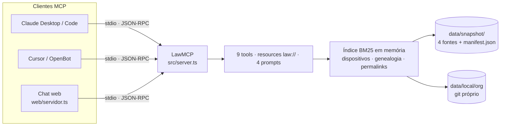

<div align="center">

# ⚖️ LawMCP

**Lei com recibo para qualquer agente de IA.**

Servidor **MCP (Model Context Protocol)** para consultar, citar e **verificar** leis de várias jurisdições.<br>
Cada resposta traz o texto oficial, a vigência e o **permalink do commit exato** de onde o texto saiu.

    

[Para revisores](#-para-revisores-em-30-segundos) · [Rodar em 1 minuto](#-rodar-em-1-minuto) · [Como funciona](#️-como-funciona) · [Tools](#-a-superfície-mcp) · [Demo](#-demo) · [Documentação](docs/README.md)

</div>

---

## 🧭 Para revisores (em 30 segundos)

| | |
|---|---|
| **Problema** | Agentes de IA citam lei de memória: inventam artigos e incisos, citam norma revogada e não mostram a fonte. Já são centenas de decisões judiciais sobre citações inventadas por IA. |
| **Solução** | Um servidor MCP que qualquer cliente (Claude Desktop, Claude Code, Cursor, OpenBot…) liga com uma linha. O agente passa a buscar, ler e **conferir** a lei antes de responder. |
| **Diferencial** | **Lei com recibo:** cada artigo vem com o permalink do commit no GitHub. O link não muda quando a fonte é atualizada, então dá para auditar a resposta depois. |
| **Por que MCP** | O tema do hackathon. Usamos as três primitivas: **9 tools**, **resources** `law://…` e **4 prompts**, além de instruções do servidor que proíbem citar lei de memória. |
| **Escopo real** | 15.162 documentos de 4 fontes abertas: Brasil federal (43 normas, incluindo CF, CLT, CDC e 17 códigos), Birigui/SP e Espanha. Normas privadas de empresas, versionadas em git. |
| **Qualidade** | TypeScript estrito, 24 testes (`node:test`), incluindo um ponta a ponta com cliente MCP real via stdio. Sem frameworks; 3 dependências de runtime. |

## 🔎 Exemplo real

Pergunta ao agente: *"Verifique: segundo o art. 49 e o art. 999 do CDC e o art. 7º, inciso XCIX, da CF…"*. A tool `verificar_citacoes` devolve (saída real, resumida):

```json
{
  "citacoes": [
    { "citacao": "art. 49 do CDC", "status": "ok",
      "permalink": "https://github.com/Evaldoes/legislacao-br/blob/9dbcbd3…/normas/lei-8078-1990/art-049.md" },
    { "citacao": "art. 999 do CDC", "status": "inexistente",
      "detalhe": "Código de Defesa do Consumidor: vai do art. 1 ao art. 119; não há art. 999." },
    { "citacao": "art. 7º, inciso XCIX, da CF", "status": "inexistente",
      "detalhe": "o art. 7º tem incisos I a XXXIV; § 1º, § 2º, § 3º; não há inciso XCIX." }
  ],
  "resumo": { "ok": 1, "revogada": 0, "inexistente": 2, "divergente": 0, "fora_da_base": 0 }
}
```

E `impacto_da_norma("Reforma Trabalhista")` mostra os **378 dispositivos da CLT** alterados pela Lei 13.467/2017, cada um com a nota de redação e o link.

## 🚀 Rodar em 1 minuto

```sh
nvm use          # Node 24+ (roda .ts direto, sem build)
npm ci
npm test         # 24 testes, incluindo um ponta a ponta via stdio
npm run web      # chat em http://localhost:5173 (cliente MCP de demonstração)
```

Os dados já vêm no repositório (`data/snapshot/`), sem download nem chave de API.

### Plugar num cliente MCP

**Claude Code:**

```sh
claude mcp add lawmcp -- "$(which node)" "$PWD/src/server.ts"
```

**Claude Desktop** (`~/Library/Application Support/Claude/claude_desktop_config.json`), **Cursor** (`~/.cursor/mcp.json`) e outros clientes stdio:

```json
{
  "mcpServers": {
    "lawmcp": {
      "command": "/caminho/absoluto/do/node24",
      "args": ["/caminho/absoluto/FibonacciHackathon/src/server.ts"]
    }
  }
}
```

**MCP Inspector** (testar as tools no navegador): `npx @modelcontextprotocol/inspector node src/server.ts`

Passo a passo e problemas comuns (inclusive OpenBot): [docs/INSTALACAO.md](docs/INSTALACAO.md).

## 🏗️ Como funciona



- **Adaptadores** (`src/dados/adaptadores.ts`) convertem cada fonte para o contrato `Norma` (`src/types.ts`). Município ou pasta de Markdown nova entra por `data/snapshot/fontes.json`, **sem código**.
- **Permalink:** o `manifest.json` guarda o commit de cada fonte; somado ao caminho do arquivo, vira um link imutável.
- **Genealogia:** vem das notas oficiais ("Redação dada pela Lei nº 13.467/2017"), indexadas ao contrário para responder "o que esta lei mudou?".
- **Normas privadas** ficam em `law://local/{org}/…`, num repositório git separado. O histórico de versões sai do próprio git. Jurisdições oficiais nunca são alteradas.
- **O chat web é só mais um cliente MCP:** fala com o servidor pelo protocolo, nunca importa o índice. Tools que gravam ficam bloqueadas na web.

Página visual com diagramas e tempos medidos: [docs/visual/lawmcp-ponta-a-ponta.html](docs/visual/lawmcp-ponta-a-ponta.html).

## 🧰 A superfície MCP

### Tools

| Tool | O que faz |
|---|---|
| `listar_jurisdicoes` | O que está carregado (`br/federal`, `br/sp/birigui`, `es`, `local/…`) e o commit de cada fonte |
| `buscar_normas` | Busca BM25 com filtro de jurisdição (prefixo), tipo e ano |
| `ler_norma` | Norma, artigo **ou dispositivo**: `law://br/federal/constituicao-1988/art-5/inc-13` |
| `verificar_citacoes` | Confere citações até inciso e parágrafo ("arts. 5º a 7º", "§ 1º do art. 59 da CLT"): `ok`, `revogada`, `inexistente`, `divergente` ou `fora_da_base` |
| `historico_norma` | Quem alterou cada dispositivo e como; em normas privadas, as versões do git com o diff por artigo |
| `impacto_da_norma` | O que uma lei mudou em outras ("Reforma Trabalhista" → 378 dispositivos da CLT) |
| `comparar_jurisdicoes` | O mesmo tema em vários países, lado a lado |
| `adicionar_norma` | Grava uma norma privada em `law://local/{org}/…`, versionada em git (B2B) |
| `importar_normas` | Transforma uma pasta de Markdown na jurisdição `local/{org}`; reimportar grava só o que mudou |

### Resources, prompts e instruções

- **Resources:** cada norma é um documento `law://…` que o cliente pode anexar ao contexto, mais `lawmcp://sobre` (cobertura e commits).
- **Prompts:** `responder_com_citacao`, `explicar_para_cidadao`, `revisar_peca`, `comparar_paises`.
- **Instruções do servidor:** nunca citar lei de memória e verificar as citações antes de responder.

Entradas e saídas de cada tool: [docs/03-referencia-mcp.md](docs/03-referencia-mcp.md).

## 🎬 Demo

Roteiro de palco de 3 minutos: [docs/DEMO.md](docs/DEMO.md). Perguntas que funcionam em qualquer cliente:

1. *"O art. 49 do CDC ainda vale? Cite a fonte."*
2. *"Verifique as citações: segundo o art. 999 do CDC e o art. 7º, inciso XCIX, da CF, o consumidor recebe em dobro."*
3. *"O que a Reforma Trabalhista mudou na CLT?"* · *"Quem alterou o art. 59 da CLT?"*
4. *"Compare as regras de horas extras no Brasil e na Espanha."*
5. *"Que leis de Birigui falam de IPTU?"*
6. *"Importe a pasta /Users/…/politicas como escritorio-silva."* → *"O que mudou na última versão da política de home office?"*

**Chat web** (`npm run web`): chat com modos (buscar, verificar, impacto, histórico, Brasil × Espanha), filtro de jurisdição, leitor da norma com recibo e o painel **Bastidores MCP**, que mostra cada chamada de tool. Com o Claude Code logado, perguntas em linguagem leiga ("devolver compra pela internet") são traduzidas para o vocabulário da lei (CDC, art. 49); sem ele, a web usa só regras.

## 👥 Para quem

| Público | O que ganha |
|---|---|
| **Advogados** | Conferir as citações de uma peça até o inciso, ver a genealogia de um artigo, saber o que uma reforma mudou |
| **Empresas e escritórios** | Políticas internas e contratos-padrão consultáveis e citáveis pelo agente, com histórico de versões |
| **Cidadãos** | Explicação simples, com a lei por trás e o link para conferir |
| **Devs de agentes** | Uma fonte jurídica verificável no lugar da memória do modelo |

## 📚 Dados e fontes

| Jurisdição | Documentos | Fonte | Licença |
|---|---|---|---|
| `br/federal` | 11.956 | [legislacao-br](https://github.com/Evaldoes/legislacao-br) + [LawCodex/br](https://github.com/LawCodex/br) | CC0 / atos oficiais |
| `br/sp/birigui` | 654 | [ctresb/leis](https://github.com/ctresb/leis) | Atos oficiais |
| `es` | 2.552 | [legalize-es](https://github.com/legalize-dev/legalize-es) (BOE) | Reuso do BOE |
| `local/{org}` | conforme o uso | Pastas do usuário | Privadas |

Atualizar: `npm run data:fetch`. Adicionar município ou país sem programar: [docs/05-jurisdicoes-proprias.md](docs/05-jurisdicoes-proprias.md).

## 🗂️ Estrutura

```
src/server.ts              servidor MCP (stdio): tools, resources, prompts e instruções
src/types.ts               contrato compartilhado (Norma, URIs, entradas e saídas)
src/citacoes.ts            verificador de citações (listas, faixas, incisos, parágrafos)
src/dados/                 adaptadores, índice BM25, texto jurídico, catálogo de apelidos, normas locais
src/scripts/fetch-data.ts  regenera data/snapshot/ e o manifest.json
web/                       chat web: cliente MCP via stdio + front em HTML/CSS/JS puro
data/snapshot/             leis da demo, manifest.json (commits) e fontes.json
docs/                      documentação completa (índice em docs/README.md)
```

## 🛠️ Comandos

| Comando | O que faz |
|---|---|
| `npm run mcp` / `npm run dev` | Servidor MCP via stdio (dev reinicia ao salvar) |
| `npm run web` | Chat web em `http://localhost:5173` (`PORT`, `CLAUDE_MODEL`) |
| `npm test` | 24 testes com `node:test` |
| `npm run typecheck` / `npm run build` / `npm start` | Checagem de tipos, build em `dist/` e versão compilada |
| `npm run data:fetch [-- <fonte>…]` | Atualiza o snapshot |

Variáveis opcionais: `LAWMCP_DATA` (pasta do snapshot) e `LAWMCP_LOCAL` (onde as normas privadas são gravadas; padrão `data/local/`, fora do git do projeto).

## ⚠️ Limitações conhecidas

- A busca usa radical por truncamento ("igualdade" não acha "iguais").
- O verificador ainda não confere alíneas nem "art. 5º" sem a norma.
- Roda só local (stdio), sem autenticação: todas as organizações locais ficam visíveis a quem conecta.
- Conteúdo informativo de fontes abertas: **não substitui a publicação oficial nem aconselhamento jurídico.**

Lista completa e o porquê de cada decisão: [docs/09-decisoes-e-limitacoes.md](docs/09-decisoes-e-limitacoes.md).

## 📖 Documentação

| Quero… | Leia |
|---|---|
| Entender o produto e o problema | [01. Visão geral](docs/01-visao-geral.md) |
| Entender o código | [02. Arquitetura](docs/02-arquitetura.md) |
| Ver o contrato de cada tool | [03. Referência MCP](docs/03-referencia-mcp.md) |
| Saber de onde vêm as leis | [04. Dados e fontes](docs/04-dados-e-fontes.md) |
| Entender o verificador | [06. Verificador de citações](docs/06-verificador-de-citacoes.md) |
| Rodar e escrever testes | [08. Testes e qualidade](docs/08-testes-e-qualidade.md) |

Feito no **FibonacciHackathon** (tema: integração via MCP). Estado do projeto: [CONTEXTO.md](CONTEXTO.md) · regras para agentes e colegas: [AGENTS.md](AGENTS.md).
