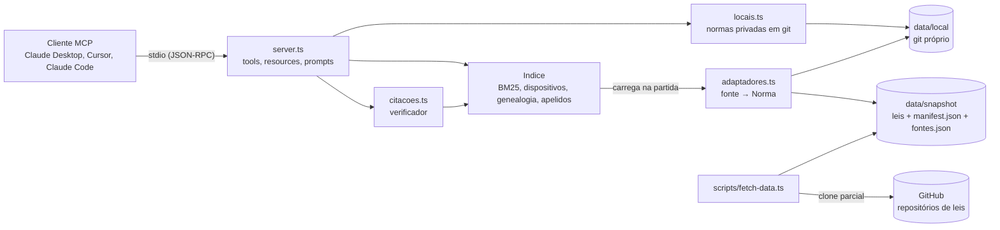

# 02. Arquitetura

## Visão geral

Diagrama de componentes. Objetivo: mostrar quem chama quem, da conversa com o cliente até os arquivos. Evidência: imports de `src/server.ts`, `src/dados/indice.ts` e `src/scripts/fetch-data.ts`.



O cliente MCP inicia o processo `node src/server.ts` e conversa com ele pelo stdin e stdout. O servidor carrega todas as leis num índice em memória, e as tools consultam esse índice. As normas privadas são gravadas num repositório git separado e entram no mesmo índice.

## Módulos

| Arquivo | Responsabilidade |
|---|---|
| `src/server.ts` | Cria o `McpServer` (versão 0.2.0) com 9 tools, 2 resources, 4 prompts e as instruções. Valida as entradas com zod e formata as respostas em JSON com o aviso legal. Executado direto, conecta o stdio. |
| `src/types.ts` | Contrato compartilhado: `Norma`, `Origem`, `Alteracao`, `LawUri` e as entradas e saídas de cada tool. Mudanças aqui se combinam com o time. |
| `src/citacoes.ts` | Verificador de citações ([06](06-verificador-de-citacoes.md)). |
| `src/dados/indice.ts` | Classe `Indice`: carga das fontes, busca BM25, leitura de dispositivos, genealogia, impacto, apelidos e permalinks. |
| `src/dados/adaptadores.ts` | Um adaptador por formato de fonte, que converte arquivos Markdown em `Norma`. Também lê o `fontes.json`. |
| `src/dados/texto.ts` | Texto jurídico: normalização, tokens, divisão em artigos e dispositivos, números romanos, atos citados ("Lei nº 13.467, de 2017") e notas de alteração. |
| `src/dados/catalogo.ts` | Nomes pelos quais as normas são citadas (CF, CDC, LGPD, "Reforma Trabalhista", CE…). |
| `src/dados/locais.ts` | Normas privadas: gravação com commit, importação de pasta e versões a partir do git. |
| `src/dados/frontmatter.ts` | Separa o cabeçalho YAML do corpo Markdown. |
| `src/scripts/fetch-data.ts` | Baixa as fontes do GitHub (clone parcial com sparse checkout) e regenera `data/snapshot/` e o `manifest.json`. |

## Ciclo de vida do servidor

1. `npm run mcp` (ou o cliente MCP) executa `src/server.ts`. O Node 24 roda TypeScript direto, sem build.
2. `Indice.carregar(DIR_SNAPSHOT, DIR_LOCAL)` começa a carregar as fontes como uma promessa.
3. O transporte stdio conecta na hora, sem esperar a carga. As tools aguardam o índice ficar pronto.
4. O tempo de carga vai para o stderr: cerca de 4 s com o disco em cache e de 9 a 14 s a frio. Heap de cerca de 112 MB.

Regra fixa: **o stdout é do protocolo MCP**. Qualquer log usa `console.error`.

## Modelo de dados

Tudo é uma `Norma`: a lei inteira, cada artigo e cada dispositivo lido na hora.

| Campo | Exemplo |
|---|---|
| `uri` | `law://br/federal/lei-8078-1990/art-49` |
| `jurisdicao` | `br/federal`, `br/sp/birigui`, `es`, `local/escritorio-silva` |
| `tipo` | `lei`, `código`, `artigo`, `dispositivo`, `artículo`, `norma interna`… |
| `titulo`, `numero`, `data` | `Art. 49, Código de Defesa do Consumidor`, `49`, `1990-09-11` |
| `situacao` | `vigente`, `revogada` ou `desconhecida` |
| `fonte` | URL oficial (Planalto, BOE…) |
| `texto` | Markdown do texto oficial |
| `origem` | `repo`, `caminho`, `commit` e `permalink` do arquivo de onde saiu |
| `alteracoes` | Genealogia: dispositivo, tipo, nota e norma alteradora |
| `apelidos` | Nomes usados nas citações |

### URIs

```
law://<jurisdicao>/<norma>[/<artigo>[/<dispositivo>]]

law://br/federal/constituicao-1988                  norma inteira
law://br/federal/constituicao-1988/art-5            artigo
law://br/federal/constituicao-1988/art-5/inc-13     inciso XIII
law://br/federal/decreto-lei-5452-1943/art-59/par-1 § 1º
law://br/federal/lei-8078-1990/art-49/par-unico     parágrafo único
law://es/BOE-A-1978-31229/art-14                    artículo 14
law://local/escritorio-silva/politica-de-home-office  norma privada
```

- Artigos: `art-1025` (art. 1.025), `art-7-a` (art. 7º-A), `art-2-bis`, `adct-art-1` (ADCT).
- Dispositivos: `caput`, `inc-N`, `par-N`, `par-unico` e aninhados (`par-2-inc-1`). Um bloco inclui os filhos: ler um parágrafo traz os incisos dele.
- Normas brasileiras federais usam `<tipo>-<número>-<ano>` (`lei-13709-2018`, `decreto-lei-2848-1940`, `lei-complementar-123-2006`). A CF é `constituicao-1988`.

## Índice e busca

- **BM25** sobre um índice invertido (k1 = 1,2; b = 0,75). O título vale 3 vezes o texto.
- Tokens: minúsculos, sem acento, sem stopwords de português e espanhol, com radical por truncamento em 7 letras ("arrependimento" e "arrependido" casam).
- Consultas com até 2 termos exigem todos; com mais, 60% deles. A frase exata da consulta multiplica o score por 1,8.
- Postings guardados como arrays planos `[documento, frequência, …]`, o que derrubou o heap de cerca de 296 MB para 95 MB.
- **Trechos:** artigos com mais de 1.200 caracteres também são indexados por dispositivo (caput, cada inciso, cada parágrafo), numa segunda coleção BM25. O artigo vale a maior nota entre ele inteiro e o seu melhor trecho. Sem isso, o caput do art. 5º da CF ("iguais perante a lei… à igualdade") sumia entre os 78 incisos, porque o BM25 pune documentos longos. Custo: cerca de 14,5 mil trechos e 17 MB a mais de heap (112 MB no total).
- Filtros: jurisdição por prefixo (`br` inclui `br/sp/birigui`), tipo e ano.

## Dispositivos e genealogia

- `dividirDispositivos` quebra um artigo em caput, incisos, parágrafos e parágrafo único, usando as âncoras do legislacao-br ou o padrão do texto ("XIII -", "§ 1º", "Parágrafo único").
- A genealogia vem das notas das fontes ("Redação dada pela Lei nº 13.467, de 2017", "Incluído pela Lcp nº 123, de 2006"). Cada nota vira uma `Alteracao` com tipo (`redacao`, `inclusao`, `revogacao`, `renumeracao`, `vigencia`, `vide`, `outro`) e a URI da norma alteradora.
- O índice guarda o caminho inverso (`alteradasPor`): é ele que responde ao `impacto_da_norma`.
- Para normas privadas, o histórico vem do git local ([05](05-jurisdicoes-proprias.md)).

## Atualização em tempo de execução

`adicionar_norma` e `importar_normas` gravam o arquivo, fazem o commit e chamam `Indice.substituir`, que troca a norma e seus artigos sem recarregar o resto. Os documentos antigos ficam órfãos e somem das respostas. Depois disso, o servidor avisa o cliente que a lista de resources mudou.

## Princípios

- Nunca escrever no stdout do servidor stdio.
- Nunca gravar em jurisdições oficiais: normas privadas só entram em `local/{org}`.
- O snapshot mantém os caminhos dos repositórios de origem, para o permalink apontar para o arquivo certo.
- Toda tool nova tem teste.
- Shortcut assumido: índice só em memória. Acima de cerca de 200 mil normas, a troca é por SQLite FTS5.

## Evidências

`src/server.ts`, `src/dados/indice.ts` (constantes `K1`, `B`, `PESO_TITULO`, `URI_DISPOSITIVO`), `src/dados/texto.ts` (`tokenizar`, `radical`, `idArtigo`, `dividirDispositivos`, `tipoAlteracao`), `src/types.ts`, `AGENTS.md`, `CONTEXTO.md`.
