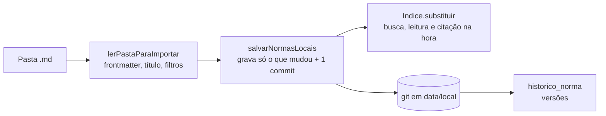

# 05. Jurisdições próprias

Há três formas de colocar leis novas no LawMCP:

| Forma | Para quê | Onde fica | Versionamento | Precisa reiniciar? |
|---|---|---|---|---|
| `fontes.json` | Fonte oficial nova: outro município do ctresb, uma pasta de Markdown de um estado ou país | `data/snapshot/<pasta>/` | Commit da fonte no `manifest.json` | Sim |
| `adicionar_norma` | Uma norma privada, pelo chat | `data/local/<org>/` | Um commit por versão no git local | Não |
| `importar_normas` | Uma pasta inteira de normas privadas | `data/local/<org>/` | Um commit por importação | Não |

Uma fonte com formato novo, diferente de `ctresb` e `markdown`, ainda precisa de um adaptador em código (veja o fim desta página).

## Fonte oficial sem programar: `fontes.json`

Arquivo: `data/snapshot/fontes.json`. O Birigui já está registrado nele:

```json
{
  "fontes": [
    {
      "pasta": "br-sp-birigui",
      "jurisdicao": "br/sp/birigui",
      "formato": "ctresb",
      "repo": "ctresb/leis",
      "caminho": "municipais/SP/birigui",
      "ignorar": "^_auditoria"
    }
  ]
}
```

| Campo | Obrigatório | Regra |
|---|---|---|
| `pasta` | sim | Slug; nome da pasta em `data/snapshot/`. Não pode repetir nem coincidir com as fontes do código |
| `jurisdicao` | sim | Ex.: `br/sp/campinas`, `us/ca`. O prefixo `local/` é reservado para normas privadas |
| `formato` | sim | `ctresb` (município do ctresb/leis) ou `markdown` (um `.md` por norma) |
| `repo` | não | `dono/repositorio` no GitHub. Sem ele, os arquivos ficam direto em `data/snapshot/<pasta>/` e não há permalink |
| `caminho` | não | Pasta dentro do repo. Padrão: a raiz (`.`) |
| `ignorar` | não | Regex de nomes de arquivo a pular no download |

### Passo a passo

1. Adicione a entrada no `fontes.json`.
2. Rode `npm run data:fetch -- <pasta>`. Se não houver `repo`, copie os `.md` para `data/snapshot/<pasta>/`.
3. Reinicie o servidor MCP (no Claude Desktop, reinicie o app).
4. Confira com `listar_jurisdicoes`.

Exemplo de outro município do ctresb:

```json
{ "pasta": "br-sp-campinas", "jurisdicao": "br/sp/campinas", "formato": "ctresb", "repo": "ctresb/leis", "caminho": "municipais/SP/campinas" }
```

Se o arquivo tiver erro (campo inválido, `local/` na jurisdição, pasta repetida), o servidor não sobe e mostra a mensagem no log: por exemplo `jurisdicao: local/ é reservado para normas privadas`.

## Formato Markdown de uma norma

Vale para o formato `markdown` do `fontes.json` e para `importar_normas`. O frontmatter é opcional.

```markdown
---
titulo: Lei Municipal nº 100/2020
tipo: lei ordinária
numero: "100"
data: 2020-03-15
fonte: https://camara.exemplo.gov.br/lei-100-2020
apelidos: [Lei do Parque]
revogada: false
---

# Lei Municipal nº 100/2020

Art. 1º Fica criado o parque municipal.

Art. 2º Esta Lei entra em vigor na data de sua publicação.
```

- Título: `titulo` do frontmatter, depois o primeiro `# Título` e, por último, o nome do arquivo.
- URI: `law://<jurisdicao>/<nome-do-arquivo-em-slug>`.
- Artigos: cada linha que começa com "Art. N" (também "Artigo" e "Artículo", com ou sem `**` e `#`) abre um artigo, que vai até o próximo artigo ou título.
- Situação: `revogada: true` ou `false`. Sem o campo, fica `desconhecida` nas fontes oficiais e `vigente` nas privadas.

## Normas privadas

As normas privadas de um escritório ou empresa entram sempre em `law://local/<organizacao>/…`, nunca numa jurisdição oficial.

```
data/local/                      repositório git próprio (LAWMCP_LOCAL muda o lugar)
├── .git/
├── escritorio-silva/
│   ├── politica-de-home-office.md
│   └── codigo-de-etica.md
└── empresa-x/
    └── regulamento-de-ferias.md
```

- `data/local/` está no `.gitignore` do projeto: as normas privadas nunca sobem para o repo do LawMCP.
- Os commits são feitos como `LawMCP <lawmcp@local>`, sem assinatura, com mensagens "Adiciona …", "Atualiza …" ou "Importa N norma(s) em …".
- Na partida, o servidor carrega tudo o que estiver em `data/local/`.

### Uma norma: `adicionar_norma`

Pelo chat: "Adicione a política de home office do escritorio-silva, apelido PHO: Art. 1º O trabalho remoto é permitido duas vezes por semana. Art. 2º O equipamento é fornecido pela empresa."

```json
{ "uri": "law://local/escritorio-silva/politica-de-home-office", "commit": "…", "artigos": 2, "novaVersao": false }
```

Na hora, a norma aparece em `buscar_normas`, pode ser lida por artigo e "art. 2º da PHO" passa a ser conferido pelo verificador. Mandar a mesma norma de novo cria uma versão nova; se nada mudou, não há commit.

### Uma pasta: `importar_normas`

Pelo chat: "Importe a pasta /Users/ana/Documentos/politicas como empresa-x."

```json
{
  "jurisdicao": "local/empresa-x",
  "commit": "…",
  "total": 2, "novas": 2, "atualizadas": 0, "inalteradas": 0,
  "normas": [
    { "uri": "law://local/empresa-x/codigo-de-etica", "titulo": "Código de Ética", "artigos": 2 },
    { "uri": "law://local/empresa-x/regulamento-de-ferias", "titulo": "Regulamento de Férias", "artigos": 1 }
  ],
  "ignorados": [{ "arquivo": "vazio.md", "motivo": "texto vazio" }]
}
```

- Lê só `.md`, inclusive em subpastas. Pula README, pastas ocultas (como `.git`), arquivos vazios, arquivos acima de 200 mil caracteres e títulos repetidos, e diz o motivo de cada um.
- Limite: 500 arquivos por importação.
- Reimportar a mesma pasta grava só o que mudou, num commit novo.

Fluxo da importação. Objetivo: mostrar por onde passa uma pasta até virar norma citável e versionada. Evidência: tool `importar_normas` em `src/server.ts` e funções de `src/dados/locais.ts`.



### Versões: `historico_norma`

Para uma norma privada, `historico_norma` lê o git e mostra cada versão com os artigos que mudaram em relação à anterior:

```json
{
  "uri": "law://local/empresa-x/regulamento-de-ferias",
  "versoes": [
    { "commit": "…", "data": "2026-11-19T15:02:11-03:00", "mensagem": "Importa 1 norma(s) em empresa-x",
      "incluidos": ["art-2"], "alterados": ["art-1"], "removidos": [] },
    { "commit": "…", "data": "2026-11-19T14:40:03-03:00", "mensagem": "Importa 2 norma(s) em empresa-x",
      "incluidos": ["art-1"], "alterados": [], "removidos": [] }
  ]
}
```

Consultando um artigo (`…/regulamento-de-ferias/art-1`), aparecem só as versões que mexeram nele. São mostradas até 50 versões.

## Segurança e limites

- Organização é sempre um slug (`[a-z0-9-]`, até 40 caracteres), e o caminho final é conferido para não sair de `data/local/`.
- `importar_normas` lê qualquer pasta que o cliente indicar, mas só arquivos `.md`. O cliente MCP pede aprovação da chamada. Se um dia o servidor sair do stdio local, essa tool precisa de uma pasta permitida.
- Não há tool para remover uma norma local. Hoje, apague o arquivo e faça o commit à mão em `data/local/`.
- Todas as organizações locais ficam visíveis para quem conecta. Não há hierarquia livre (como `local/escritorio/contratos`) nem separação por usuário.

## Fonte com formato novo: escrever um adaptador

1. Em `src/dados/adaptadores.ts`, crie um `Adaptador` (`nome`, `jurisdicoes`, `carregar(dir)`) que devolva `Norma[]`. Reaproveite `arquivosMd`, `lerFrontmatter` e `normaComArtigos`.
2. Registre em `FONTES` (pasta → adaptador).
3. Em `src/scripts/fetch-data.ts`, adicione a fonte (repo, sparse checkout, pasta de origem).
4. Mantenha em `origem.caminho` o caminho do arquivo no repo de origem, para o permalink funcionar.
5. Escreva um teste em `src/lawmcp.test.ts` e atualize `data/snapshot/FONTES.md` com a licença.

## Evidências

`data/snapshot/fontes.json`, `src/dados/adaptadores.ts` (`FonteConfig`, `fontesConfiguradas`, `todasAsFontes`, `pastaMarkdown`, `normasDeMarkdown`), `src/dados/locais.ts`, `src/server.ts` (`adicionar_norma`, `importar_normas`, `historico_norma`), `.gitignore` e os testes "fontes.json…", "MCP: adicionar_norma…" e "MCP: importar_normas…". As datas e commits do exemplo de versões são ilustrativos.
