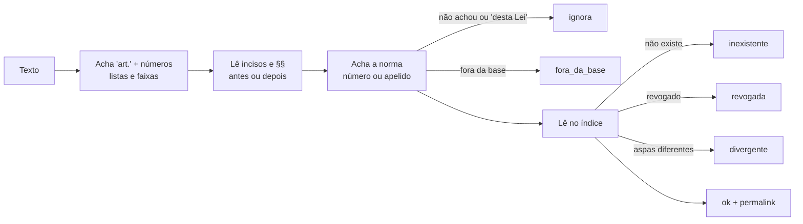

# 06. Verificador de citações

`verificar_citacoes` recebe um texto (petição, parecer, resposta de um agente) e confere cada citação de lei contra a base, até o nível de inciso e parágrafo. É a tool que mais diferencia o LawMCP: transforma "o modelo disse" em "o texto oficial diz, e aqui está o link".

## Status

| Status | Quando | Exemplo de `detalhe` |
|---|---|---|
| `ok` | Artigo ou dispositivo existe, está vigente e o trecho entre aspas (se houver) bate com o oficial | — |
| `revogada` | Existe, mas foi revogado | art. 117 da CF; art. 3º, II, do Código Civil |
| `inexistente` | A norma está na base, mas o artigo ou dispositivo não existe | "Código de Defesa do Consumidor: vai do art. 1 ao art. 119; não há art. 999." |
| `divergente` | O trecho entre aspas logo depois da citação é diferente do texto oficial | "prazo de 30 dias" atribuído ao art. 49 do CDC (o oficial diz 7) |
| `fora_da_base` | A norma foi reconhecida, mas não está carregada | "Lei nº 8.666/1993 não está carregada no LawMCP; não dá para confirmar nem negar. Confira na fonte oficial." |

Cada citação volta com a `uri`, o `permalink` (quando existe) e, no fim, um `resumo` com a contagem por status.

## Formatos reconhecidos

Todos estes casos são testados:

| Citação | Resultado |
|---|---|
| Conforme o art. 186 do Código Civil | `ok` …/lei-10406-2002/art-186 |
| O art. 5º da CF garante a igualdade | `ok` …/constituicao-1988/art-5 |
| arts. 5º, 6º e 7º da Constituição Federal | três `ok` (lista) |
| arts. 1º a 3º da LGPD | três `ok` (faixa) |
| art. 5º, XIII e XIV, da CF/88 | `ok` inc-13 e inc-14 |
| CF, art. 5º, LXXVIII | `ok` inc-78 (norma antes do artigo) |
| o § 1º do art. 59 da CLT | `ok` …/art-59/par-1 (dispositivo antes do artigo) |
| art. 1.228, § 1º, do CC | `ok` …/art-1228/par-1 |
| art. 7º, inciso XCIX, da CF | `inexistente` |
| art. 999 do CDC | `inexistente` |
| art. 117 da Constituição | `revogada` |
| art. 3º, II, do Código Civil | `revogada` |
| Lei 9.999/2020, art. 3º | `fora_da_base` |
| art. 37 da Lei 8.666/93 | `fora_da_base` |
| art. 33 da Lei 11.343/2006 | `ok` |
| artículo 14 de la Constitución Española | `ok` …/es/BOE-A-1978-31229/art-14 |
| artículo 1902 del Código Civil | `ok` Código Civil espanhol |
| art. 3º desta Lei | nenhuma citação (referência interna) |

## Como funciona

1. **Artigos.** Procura "art.", "arts.", "artigo", "artículo" seguidos de número e lê listas ("5º, 6º e 7º"), faixas ("1º a 3º", até 15 artigos expandidos; acima disso, só as pontas) e sufixos ("7º-A", "14 bis").
2. **Dispositivos.** Logo depois do número: ", XIII", ", inciso XIII", ", § 1º", ", parágrafo único", ", caput". Ou antes do artigo: "inciso XIII do art. 5º", "§ 1º do art. 59". Alíneas são lidas e descartadas.
3. **Norma.** Procura, nesta ordem de preferência, a norma citada depois do artigo (até 40 caracteres) ou antes (até 25), sem atravessar fim de frase nem o próximo "art.". Reconhece:
   - atos com número: "Lei 8.078/90", "Lei nº 13.709, de 14 de agosto de 2018", "Lei Complementar nº 123/2006";
   - apelidos do catálogo e títulos das normas: "CDC", "Código Civil", "Constituição Federal", "LGPD", e os apelidos das normas privadas.
4. **Jurisdição.** "Código Civil" é o brasileiro, a menos que o texto tenha pistas de espanhol ("artículo", "del", "de la", "apartado") ou que `jurisdicao: "es"` seja passado.
5. **Siglas.** Só casam em maiúsculas. Assim "CC" não vira citação no meio de uma palavra minúscula, e siglas parecidas com números romanos não são lidas como inciso.
6. **Conferência.** Lê o artigo ou dispositivo no índice, olha a situação e, se houver aspas a até 20 caracteres da citação, compara o trecho com o oficial (ignorando pontuação e espaços).

Fluxo de decisão do status. Objetivo: mostrar quando cada status é atribuído. Evidência: `verificarCitacoes` em `src/citacoes.ts`.

## Exemplo real

Entrada:

> Segundo o art. 49 do CDC, o art. 999 do CDC, o art. 7º, inciso XCIX, da CF e o art. 5º da LGPD…

Saída resumida: `ok` (art. 49 do CDC), `inexistente` ("vai do art. 1 ao art. 119; não há art. 999"), `inexistente` ("o art. 7º tem incisos I a XXXIV; § 1º, § 2º, § 3º; não há inciso XCIX") e `ok` (art. 5º da LGPD), com `resumo: { ok: 2, inexistente: 2 }`.

## Limitações

- Alíneas não são conferidas.
- Citação sem norma identificável ("art. 5º" solto) fica de fora: não dá para afirmar nada.
- As normas do Birigui não são divididas em artigos, então citações de artigos de leis municipais não são conferidas por artigo. **A confirmar** qual status elas recebem hoje.
- O trecho divergente só é comparado quando está entre aspas logo depois da citação.

## Evidências

`src/citacoes.ts` (`CHAVE_ARTIGO`, `LISTA`, `FAIXA`, `DEP_*`, `ANTES_DISPOSITIVO`, `INTERNA`, `PISTA_ES`, `verificarCitacoes`), `src/dados/indice.ts` (`apelidos`), `src/dados/catalogo.ts` e os testes "verificar_citacoes: …" em `src/lawmcp.test.ts`.
